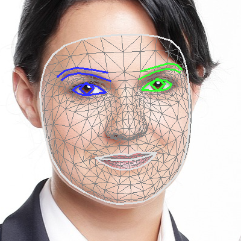
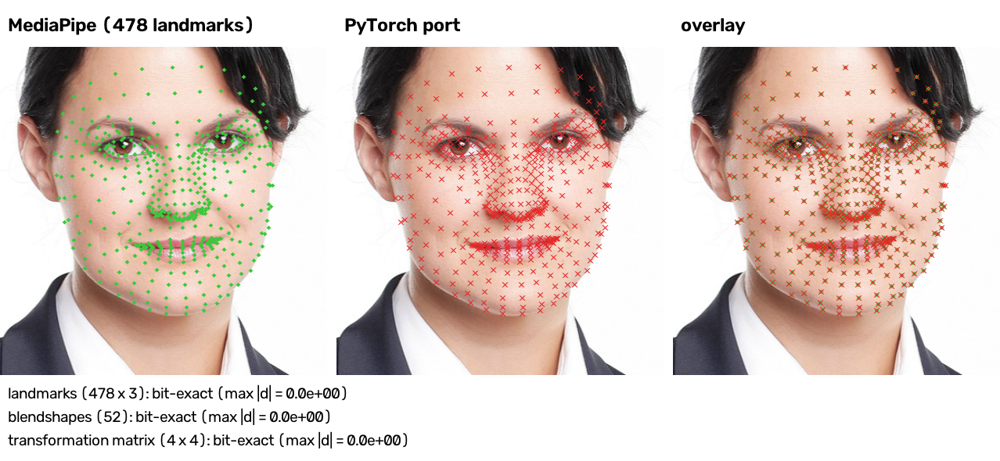

# mediapipe-face-pytorch

MediaPipe's **Face Landmarker** (`face_landmarker.task`) re-implemented in pure PyTorch — face
detection, the 478-point face mesh, 52 blendshapes and the facial transformation matrix — with
outputs that are **bit-for-bit identical** to the MediaPipe Python API. The inference path imports
only `torch` and `torchvision`; `mediapipe` is used solely by the converter's tests and the
comparison tooling.



## Comparison with MediaPipe

`compare_with_mediapipe.py` runs both pipelines on the same decoded pixels and checks every output
value for equality. On the 12 test images used during development (upright and rotated faces,
square and non-square images, a two-face image) every output matched exactly:

| image | faces | landmarks (478×3) | blendshapes (52) | transformation matrix (4×4) |
|---|---|---|---|---|
| face.jpg (958×1358) | 1 | EXACT | EXACT | EXACT |
| test.jpg (2687×3356) | 1 | EXACT | EXACT | EXACT |
| obama_rot-40.png, obama_rot25.png | 1 | EXACT | EXACT | EXACT |
| person_rot-40.png, person_rot25.png, person_rot110.png | 1 | EXACT | EXACT | EXACT |
| face_256.png, face_sq.png, obama_sq.png | 1 | EXACT | EXACT | EXACT |
| two_faces.png (`--num-faces 2`) | 2 | EXACT | EXACT | EXACT |
| obama_rot110.png | 0 | (no face in either) | | |

`render_comparison.py` draws both results on one image:



```sh
python compare_with_mediapipe.py photo.png other.png --num-faces 2   # prints EXACT / max|d| per output
python render_comparison.py photo.png docs/comparison.png            # side-by-side + overlay figure
```

Matching was verified against MediaPipe **1.1.1** (macOS arm64 wheel). Other builds of MediaPipe
accumulate floating-point sums in different orders, so their results would differ in the last bits.

## Setup

The environment is managed with direnv + uv (`.envrc` contains `layout uv`, Python 3.12):

```sh
direnv allow            # creates ~/.venvs/mediapipe-face-pytorch
uv sync                 # torch, torchvision, mediapipe (for comparisons), tflite (dev, for the converter)
python face_mesh.py photo.png          # downloads models/face_landmarker.task on first use
python convert_to_pytorch.py           # -> models/face_landmarker_torch.pt
```

## Usage

```sh
python face_mesh_torch.py photo.png --out-json mesh.json --num-faces 2
```

```python
import face_mesh_torch as fm
model = fm.FaceLandmarkerTorch(num_faces=1)           # loads models/face_landmarker_torch.pt
result = model(fm.load_image("photo.png"))            # HxWx3 uint8 RGB tensor
result["face_landmarks"][0]                           # (478, 3) normalized x, y, z
result["face_blendshapes"][0]                         # (52,) scores, names in fm.BLENDSHAPE_NAMES
result["facial_transformation_matrixes"][0]           # (4, 4)
```

The exact kernels run thousands of tiny ops, so inference takes about two seconds per image on CPU
(single-threaded on purpose; fidelity was the goal, not speed). `TFLiteGraph(..., exact=False)` uses
ordinary `conv2d` and is fast but only matches to ~1e-6.

## Files

| file | role |
|---|---|
| `convert_to_pytorch.py` | unpacks the `.task` bundle, parses the three TFLite flatbuffers (ops + float16 weights), the image-normalization metadata and the face-geometry metadata (canonical mesh, Procrustes weights) into one checkpoint |
| `face_mesh_torch.py` | the PyTorch-only pipeline: TFLite graph executor with XNNPACK-exact kernels, image→tensor crop, detector post-processing, landmark projection, blendshapes, face geometry |
| `face_mesh.py` | the original MediaPipe-API script (reference and model download) |
| `compare_with_mediapipe.py` | bit-exactness check against the MediaPipe API |
| `render_comparison.py` | comparison figure |

## Network architecture

All three networks come from Google's `face_landmarker.task` (float16 weights, converted to float32).
Layer structure below is read from the converted graphs.

### 1. Face detector — BlazeFace (short range)

* Input 128×128×3 RGB, normalized to [-1, 1]; the image is letterboxed into the square.
* 90 ops, 101 k parameters: one 5×5 stride-2 conv (3→24 channels, 64×64), then 16 *BlazeBlocks*
  (depthwise 3×3 → pointwise 1×1 → residual add → ReLU), widening 24→28→32→36→42→48→56→64→72→80→88→96
  channels with stride-2 depthwise convs (plus a max-pooled skip) at 64→32, 32→16 and 16→8.
* Two anchor-based heads on the 16×16 (2 anchors/cell) and 8×8 (6 anchors/cell) maps:
  `classificators` [896, 1] (sigmoid scores) and `regressors` [896, 16]
  (box centre/size + 6 keypoints: eyes, nose, mouth, ears). The 896 SSD anchors use strides
  8/16/16/16 with fixed size.
* Post-processing: score clipping and sigmoid, threshold 0.5, weighted non-maximum suppression
  (IoU > 0.5, score-weighted box/keypoint average), projection back through the letterbox, a face
  rectangle rotated so the eyes are horizontal and scaled by 1.5×.

### 2. Face landmarks — attention-mesh style regressor

* Input 256×256×3, normalized to [0, 1]: the rotated face rectangle cropped and squashed into the
  square.
* 220 ops, 1.2 M parameters: a 3×3 stride-2 conv (3→16, 128×128) followed by inverted-bottleneck
  residual blocks (1×1 reduce → PReLU → depthwise 3×3 → 1×1 expand → add → PReLU) at widths 16, 32,
  64 and 128 (bottlenecks 8/16/32/64); stage transitions are 2×2 stride-2 convs:
  128→64 (16 ch), 64→32 (32), 32→16 (64), 16→8, 8→4, 4→2 (128→64). 72 pointwise/2×2 convs,
  34 depthwise convs, 69 PReLU, 6 max-pools, 1 sigmoid.
* Heads: a 2×2 conv on the final 2×2×128 map gives the **1434 = 478×3 landmark coordinates**
  (x, y in crop pixels, z scaled like x; 468 mesh points + 10 iris points) and a 1-value
  **face-presence logit** (sigmoid, threshold 0.5).
* Post-processing: divide by 256, project through the crop's rotation/scale back to normalized
  image coordinates, z scaled by the crop width.

### 3. Blendshapes — MLP-Mixer over landmark tokens

* Input [1, 146, 2]: a fixed subset of 146 landmarks (x, y in image pixels).
* 133 ops, 450 k parameters, no spatial convolutions (all 19 convs are 1×1 = linear layers):
  1. normalize the points (subtract the centroid, divide by the mean point norm, fixed rescale);
  2. token mixing 146→96 and embedding 2→64, then a learned class token is prepended → 97×64;
  3. four Mixer blocks: LayerNorm → token-mixing MLP 97→384→97 (ReLU) + residual, then
     LayerNorm → channel MLP 64→256→64 (ReLU) + residual;
  4. the class token → linear 64→52 → sigmoid: the 52 ARKit-style blendshape scores
     (`_neutral`, `browDownLeft`, … `noseSneerRight`).

### 4. Face geometry (no network)

The transformation matrix comes from MediaPipe's geometry pipeline: the first 468 landmarks are
projected into a perspective camera (63° vertical FOV, near 1, far 10 000), their depth scale is
estimated twice with a weighted orthogonal Procrustes fit to a canonical metric face mesh (3×3
Jacobi SVD), and the final fit gives `[scale·R | t]`.

## How bit-exactness was reached

Matching float32 results bit-for-bit means reproducing the *order* of every operation, not just the
math. The pieces that mattered:

* **Crop (ImageToTensor).** MediaPipe's bundled OpenCV is a 5.x snapshot that still runs the classic
  fixed-point `warpPerspective` (double coordinates rounded to 1/32 pixel, Q15 bilinear weights),
  an unfused LU `getPerspectiveTransform`, but the OpenCV-5 `RotatedRect::points` formula — neither
  pip `opencv-python` 4.x nor 5.x reproduces it. Verified by tapping MediaPipe's own tensors.
* **XNNPACK kernels.** Every conv/GEMM entry is one sequential chain of fused multiply-adds from the
  bias; depthwise taps run column-major; 1×1 GEMMs tile output channels in blocks of 32 (64 for
  ≤4 rows) and a trailing partial tile goes through a two-accumulator kernel; MEAN reduces 16 lanes
  then a halving tree; LOGISTIC is XNNPACK's LUT-based NEON sigmoid. A correctly-rounded float32
  FMA (with tie handling) is emulated in float64.
* **Calculators.** MediaPipe's own C++ (NMS, projections) is compiled without FMA contraction;
  transcendentals match double-rounded results rather than the system libm.
* **Face geometry.** The wheel's Eigen is a Google-internal build compiled with reassociation, so
  summation orders were taken from the disassembly of `libmediapipe.dylib`: four 4-lane accumulators
  for contiguous sums, eight interleaved scalar accumulators (or a 2-lane group-of-four tree) for
  strided row sums, fused chains for two rows of each 3-term product, upstream Eigen's current
  `makeJacobi`.

Every stage was validated against values extracted from the running MediaPipe binary (identity and
synthetic TFLite models dropped into a copy of the `.task` bundle), and the end-to-end outputs with
`compare_with_mediapipe.py`.

## Caveats

* JPEG files: MediaPipe's own JPEG decoder differs from torchvision/cv2/PIL by up to 3 levels in
  some pixels, which changes landmarks by ~1e-4. `compare_with_mediapipe.py` therefore feeds both
  pipelines MediaPipe's decoded pixels. PNG decoding is identical.
* IMAGE mode only (no video-mode landmark smoothing / tracking).
* Results are specific to MediaPipe 1.1.1 on macOS arm64; see above.
